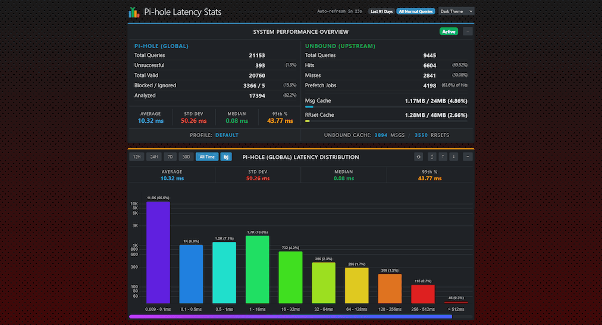

<div align="center">
  
  <br>

  

  <p>
    <b>How fast does your Pi-hole really answer? And your upstream DNS? And Unbound?</b>
  </p>
</div>

**Pi-hole Latency Stats (PHLS)** measures how quickly your **Pi-hole** answers DNS queries, how fast your **upstream servers** (Unbound, Cloudflare, Quad9, your ISP…) respond, and how well **Unbound**'s cache works. It shows everything on a **web dashboard** that updates by itself, and you manage it from the browser.

It helps you answer questions like:
- *"Is my internet slow because of DNS, or because of something else?"*
- *"Which upstream DNS server is faster for me: Cloudflare or Quad9?"*
- *"How often does Unbound answer from its cache?"*
- *"How fast is YouTube (or Netflix, or my work VPN) resolved?"*

<p align="center">
    
</p>

---

## ✨ Features

**📊 Exact statistics.** Average, median, 95th percentile and standard deviation of every answered query. Nothing is estimated or sampled: the numbers are exact, even with millions of queries.

**📶 Latency tiers.** Queries are grouped by speed (e.g. *under 1 ms*, *1–16 ms*, *over 512 ms*), so you see at a glance how many were instant and how many were slow. You choose the tiers.

**🌐 Upstream servers, one by one.** Each upstream server gets its own chart, plus a comparison table: share of queries, average, median, 95th percentile and how many replies took over 1 second. Unbound's cache answers and conditional forwarding (local names sent to your router) are kept apart, so the numbers show real upstream speed.

**🔄 Unbound.** Cache hit rate, prefetch, cache memory, cached items and Unbound's own response times, all detected automatically.

**📈 History.** Every run adds a point to the history charts, so you see trends over days and weeks.

**🎯 Profiles.** Extra dashboards for some domains only (e.g. `youtube.com,googlevideo.com`), with their own settings.

**📄 Reports.** Report profiles give a text report for any time range, on demand, which you can download or copy.

**⚙ Managed from the browser.** Settings, profiles, *Run now*, reports and **updates**, all in the dashboard. The Pi-hole password protects changes.

**⚡ Fast and light, even on a Pi Zero.** A rewritten engine reads the database once, spread over all CPU cores, and caches finished days, so a normal run reads only the newest hours. Very few writes to the SD card. See [Speed](#-speed) below.

---

## ⚡ Speed

5.0 has a completely new analysis engine. Measured on a test database with **3 million queries**:

| | v4.4 | 5.0 |
|---|---|---|
| Time for a full analysis | 10.0 s | **2.3 s** |
| CPU time used | 37 s | **3.2 s** |
| Memory (RAM) | ~760 MB | **~65 MB** |
| Copy of the Pi-hole database (`-snap`) | 146 MB in RAM | **none** |

On top of that, the **daily cache** makes normal scheduled runs faster still: on 2.7 million queries, 2.1 s → **0.8 s**. On a Pi Zero 2 W, v4.4 needed about **1 min 40 s** per dashboard run with millions of queries.

How:
- **One read.** v4.4 started about 14 database queries per run, each reading the whole database again, and sorted millions of rows for the medians. 5.0 reads every row **once**, spread over **all CPU cores**.
- **Exact medians without sorting.** Only the few rows near the median and 95th percentile are read again.
- **Daily cache.** Days that are over are counted once and kept, so a normal run reads only the last hours.
- **Fewer SD-card writes.** No database copy, and the history file grows by a few hundred bytes per run instead of being rewritten each time.

The results are identical to a full count; they were checked against an independent calculation in every mode.

---

## ✅ Requirements

- **Pi-hole v6**, installed directly on the machine (not in Docker)
- A Debian-based system with systemd: Raspberry Pi OS, Debian, Ubuntu, DietPi…
- *(Optional)* **Unbound** on the same machine, for the Unbound statistics

Everything else (`sqlite3`, a small web server for the dashboard) is installed for you.

---

## 🚀 Install

Run this one command on your Pi-hole machine:

```bash
curl -sSL https://github.com/panoc/pihole-latency-stats/releases/latest/download/install_phls.sh | sudo bash
```

It asks whether you want the web dashboard (answer **Y**) and, when upgrading from v4, whether to switch off the old cron jobs. Then it installs what is needed, sets up the schedule and runs the first analysis.

**Then open the dashboard** at the address the installer prints:

```
http://<your-pi-ip>:8080/
```

(If port 8080 is already taken, the installer picks another free port and tells you which one. You can always see the address with `phls status`.)

> **Upgrading from PHLS v4?** Run the same command. Your profiles, settings and history move over automatically, the old cron jobs are switched off, and the old dashboard address forwards to the new one. See [Upgrading from v4](docs/USAGE.md#11-upgrading-from-v4).

---

## 🖥️ The dashboard

<a href="https://raw.githubusercontent.com/panoc/pihole-latency-stats/main/assets/phls_gif_small.gif" target="_blank">

</a>

- **Header:** time of the last analysis, the countdown to the next one, a **▶ Run now** button, the profile menu and **⚙ Manage**.
- **System overview:** Pi-hole's totals and latency at a glance, next to Unbound's cache and memory.
- **Latency distribution:** all answered queries, and upstream queries only, for 12 h, 24 h, 7 days, 30 days, all time or a custom range.
- **Upstream servers:** pick one server or all of them, and compare them in a table.
- **History charts** for Pi-hole, upstream and Unbound. They have a log scale, scrolling and bar or line view, and you can reorder or collapse them.
- **Themes** (dark, light, high contrast) in the footer.

---

## 💡 Things you can find out

**Is it my Pi or my upstream?** Compare the **Pi-hole (global)** chart (everything, including cache answers) with the **upstream** chart (only queries that went out to the internet). A slow global median with a fast upstream points at the Pi itself (overloaded, slow SD card). A slow upstream points at your DNS provider or your internet connection.

**Which upstream is faster?** With more than one upstream server in Pi-hole, the comparison table on the upstream card shows each one side by side. Different servers of the same provider can perform differently, so each server is shown separately. You can group them by provider in Settings if you prefer.

**Is Unbound worth it?** The upstream card shows how many of Unbound's replies came from its own cache, and the Unbound card shows its hit rate and prefetch. Set the *Unbound cache limit* to 0 to see what your devices actually experience, cache included, and back to 4 ms to see the real upstream speed.

**How fast is one service?** Add a profile with **Domains** set, for example `youtube.com,googlevideo.com,ytimg.com`, to get its own dashboard. Or make it a **report profile** for a one-off text report over any dates.

---

## 📖 Documentation

| Guide | What's in it |
|---|---|
| 👉 **[User Guide](docs/USAGE.md)** | Dashboard, settings, profiles, reports, upstream and Unbound statistics, updating, troubleshooting |
| 👉 **[Command Line](docs/COMMAND_LINE.md)** | The `phls` command and, for advanced use, `pihole_stats.sh` options and JSON output |
| 👉 **[Manual / Offline Installation](docs/MANUAL_INSTALLATION.md)** | Installing from downloaded files, without the dashboard, or on another port |
| 👉 **[Release Notes 5.0.0](RELEASE_NOTES_5.0.0.md)** | What is new in 5.0 |

---

## 🔄 Updating

When a new version is out, the **⚙ Manage** button shows a yellow badge (e.g. `⬆ 5.0.1`). Open **⚙ Manage → PHLS → Update**, enter your Pi-hole password, and that's it. Your settings and history are kept.

From the command line: `sudo phls update`.

---

## 🗑️ Uninstalling

```bash
sudo phls uninstall
```

It asks whether to keep your settings and history (handy if you reinstall later), and removes the dashboard's web server only if PHLS installed it. Pi-hole itself is not touched.

---

<p align="center">Made by <a href="https://github.com/panoc">panoc</a> · GPLv3</p>
