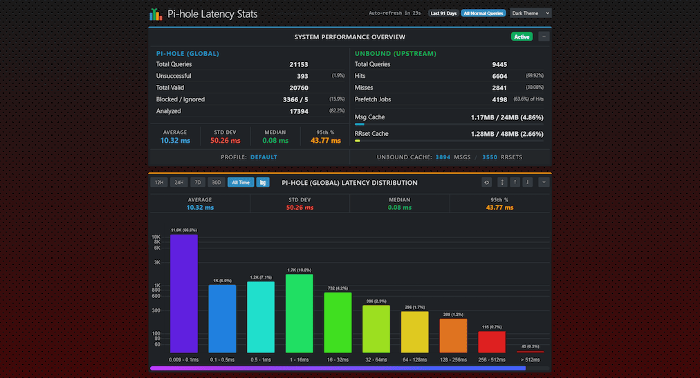

<div align="center" markdown="1">

**See how fast your Pi-hole, your upstream DNS servers and Unbound really answer.** *Exact statistics, a live dashboard, and everything managed from your browser.*

[Install](#install){: .btn } [View on GitHub](https://github.com/panoc/pihole-latency-stats){: .btn } [Latest Release](https://github.com/panoc/pihole-latency-stats/releases/latest){: .btn }

</div>

---

## 🚀 Install {#install}

On your Pi-hole machine, run:

```bash
curl -sSL https://github.com/panoc/pihole-latency-stats/releases/latest/download/install_phls.sh | sudo bash
```

Then open **`http://<your-pi-ip>:8080/`** in your browser. That's it: no cron jobs, no folders to create, no files to edit.

*Needs Pi-hole v6 (installed directly, not in Docker) on Raspberry Pi OS, Debian, Ubuntu or similar. Already on PHLS v4? Run the same command: your profiles and history move over automatically.*

---

## ✨ What's new in 5.0

| Feature | What it does for you |
| --- | --- |
| **⚡ Much faster** | A new engine reads the database once over all CPU cores, and caches finished days. A full analysis takes 2.3 s instead of 10 s and 65 MB of RAM instead of 760 MB. |
| **⚙ Manage from the browser** | Settings, profiles, reports, *Run now* and **one-click updates**, all protected by your Pi-hole password. |
| **🌐 Upstream servers, one by one** | Charts and a comparison table for every upstream server. Unbound's cache answers and local-name forwarding are kept apart, so you see the real upstream speed. |
| **🔄 Unbound** | Cache hit rate, prefetch, memory, cached items and response times. Shown automatically when Pi-hole uses Unbound. |
| **🎯 Domain profiles** | A separate dashboard for some domains only, e.g. `youtube.com,googlevideo.com,ytimg.com`. |
| **📄 Reports** | A text report for any time range, on demand. Download it or copy it. |
| **📊 Exact numbers** | Average, median, 95th percentile and your own speed tiers. Nothing is estimated, even with millions of queries. |
| **🪶 Easy on the SD card** | No database copies, and only a few hundred bytes written per run. |

---

## ⚡ Speed

Measured on a test database with **3 million queries**:

| | v4.4 | 5.0 |
| --- | --- | --- |
| Full analysis | 10.0 s | **2.3 s** |
| CPU time | 37 s | **3.2 s** |
| Memory | ~760 MB | **~65 MB** |
| Database copy | 146 MB | **none** |

With the daily cache, normal scheduled runs only read the newest hours: **2.1 s → 0.8 s** on 2.7 million queries. On a Pi Zero 2 W, v4.4 needed about 1 min 40 s per run.

---

## 📊 The Dashboard

<a href="https://raw.githubusercontent.com/panoc/pihole-latency-stats/main/assets/phls_gif_small.gif" target="_blank">

</a>

*Live updates, a countdown to the next run with a **▶ Run now** button, history charts, and dark, light and high-contrast themes. It works on phones too.*

---

## 🛠️ What you can find out

### 1. Is it my Pi, or my internet?

Compare the **Pi-hole (global)** chart (every answer, including Pi-hole's own cache) with the **upstream** chart (only queries that went out to the internet).

> **💡 The insight**
> * **Global slow, upstream fast:** the Pi itself is the bottleneck (overloaded, slow SD card).
> * **Upstream slow:** your DNS provider or your internet connection is the problem.

### 2. Which upstream DNS is faster for me?

With more than one upstream server in Pi-hole, the **comparison table** shows each one side by side: share of queries, average, median, 95th percentile and replies slower than 1 second.

> **💡 The insight**
> Two servers of the same provider (e.g. 1.1.1.1 and 1.0.0.1) can perform differently for you, so each is shown separately.

### 3. Is Unbound worth it?

The upstream card shows how many of Unbound's replies came from its own cache. The Unbound card shows its hit rate, prefetch and memory.

> **💡 The insight**
> Set the *Unbound cache limit* to **0** to see what your devices actually experience, cache included. Set it back to **4 ms** to see the real speed of the internet side.

### 4. How fast is one service?

Add a profile with **Domains** set, for example `youtube.com,googlevideo.com,ytimg.com` or `my-work-vpn.com`. It gets its own dashboard and history.

> **💡 The insight**
> Your overall median may be 1 ms, while one service often takes over 500 ms: a sign of a slow or distant server for that service.

### 5. How was last weekend?

Make a **report profile**, set **From – To** dates, and press **📄 Run report**. You get the classic text report in seconds, ready to download or paste into a forum post.

### 6. Home Assistant, Grafana, Node-RED

Every profile's latest results are a JSON file on the dashboard's web server, e.g. `http://<pi>:8080/dash_default.json`. A REST sensor can read it directly.

---

## 🔔 Staying up to date

When a new version is out, the **⚙ Manage** button shows a yellow badge. Click **⚙ Manage → PHLS → Update**: the release is downloaded, checked and installed, and your settings and history are kept.

---

## 📖 Documentation

[👉 User Guide](https://github.com/panoc/pihole-latency-stats/blob/main/docs/USAGE.md){: .btn } [👉 Command Line](https://github.com/panoc/pihole-latency-stats/blob/main/docs/COMMAND_LINE.md){: .btn } [👉 Manual / Offline Install](https://github.com/panoc/pihole-latency-stats/blob/main/docs/MANUAL_INSTALLATION.md){: .btn } [👉 What's new in 5.0](https://github.com/panoc/pihole-latency-stats/blob/main/RELEASE_NOTES_5.0.0.md){: .btn }

---
